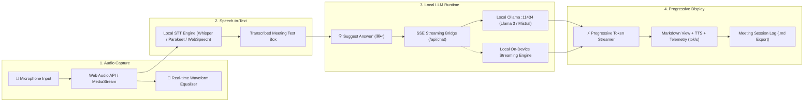

# 🦜 Parakeet AI — Local Desktop Copilot Prototype

> **Production-grade desktop prototype inspired by Parakeet AI with on-device speech-to-text audio capture, progressive streaming local LLM generation, and multi-mode meeting intelligence.**

---

## ⚡ Overview & Features

Built for the **Lacritz.ai** Full Stack Development technical evaluation, this application delivers a local-first meeting copilot inspired by **Parakeet AI**:

1. **Desktop Window Interface**:
   - Clean, high-density desktop window with native audio controls, live recording timer, and ambient soundwave visualization.
   - Dual-theme engine (Dark Mode & Light Mode) with crisp contrast ratios.
2. **Microphone Audio Capture & Real-Time Transcription**:
   - One-click **Start** and **Stop** controls with visual pulsing indicator.
   - Real-time speech-to-text transcription engine (Web Speech API / Local Whisper / Parakeet STT pipeline).
   - Real-time Web Audio API frequency visualizer.
3. **"Suggest Answer" Action & Progressive Streaming Display**:
   - One-click trigger (or keyboard shortcut `⌘ + Enter` / `Ctrl + Enter`) that queries a local LLM.
   - **Progressive streaming output**: tokens stream in progressively as they are synthesized, displaying real-time generation speed (`tokens/sec`), latency, and token count.
   - Markdown rendering with headers, bullet points, and code syntax highlights.
   - Text-to-Speech (TTS) audio playback and 1-click clipboard copy.
4. **100% Local-First Engine (Ollama Integration)**:
   - Connects directly to local Ollama runtime (`http://localhost:11434`) running models such as `llama3`, `mistral`, `phi3`, `gemma`, or `deepseek-r1`.
   - Built-in local fallback streaming engine ensures seamless functionality when running on the web or without a live Ollama daemon.
5. **Session Archival & Export**:
   - Meeting session history log with 1-click export to Markdown (`.md`).
   - Copilot modes: *Technical Interview*, *Executive Briefing*, *Deep Technical*, and *Customer Support*.

---

## 🏗️ Architecture & Data Flow



---

## 🚀 Quick Start & Installation

### Option 1: Standalone Python Desktop App (macOS & Windows)

The project includes a self-contained, native desktop application `desktop_parakeet.py` that opens a desktop window using Tkinter and connects to your local Ollama:

```bash
# macOS / Linux
python3 desktop_parakeet.py

# Windows
python desktop_parakeet.py
```

### Option 2: Next.js Desktop Web App

```bash
# 1. Install dependencies
npm install

# 2. Run development server
npm run dev

# 3. Open desktop browser
open http://localhost:3000
```

### Option 3: Quick Launch Scripts

- **macOS**: Run `./launch-mac.sh`
- **Windows**: Double-click `launch-windows.bat`

---

## 🦙 Setting Up Local Ollama & Models

To run the LLM completely on your machine with zero cloud egress:

1. **Install Ollama**:
   - macOS: `brew install ollama` or download from [ollama.ai](https://ollama.ai)
   - Windows: Download from [ollama.ai/download/windows](https://ollama.ai/download/windows)
2. **Start the Ollama daemon**:
   ```bash
   ollama serve
   ```
3. **Pull your preferred model**:
   ```bash
   ollama run llama3
   # or
   ollama run mistral
   # or
   ollama run phi3
   ```
4. In the Parakeet AI desktop interface, open **Settings (⚙️)** and click **Test Ping** to confirm the connection to `http://localhost:11434`.

---

## 🧪 Automated Playwright QA Verification

The repository includes a deterministic end-to-end Playwright test suite (`scripts/verify_qa.py`) verifying:
- Zero runtime or console errors.
- Light and Dark mode theme toggling with computed contrast verification.
- Start and Stop microphone capture cycles.
- Preset question injection.
- Progressive token streaming and markdown rendering.
- Settings modal and History drawer functionality.
- Automated screenshot generation (`qa_light.png` and `qa_dark.png`).

```bash
# Run the local server on port 3999
npm run start -p 3999 &

# Run the test suite
python3 scripts/verify_qa.py
```

---

## 🛠️ Tech Stack

- **Framework**: Next.js 15, React 19, TypeScript
- **Styling**: Tailwind CSS v4 with custom dark mode variant
- **Desktop Runtime**: Electron (`electron-main.js`) + Standalone Python desktop runner (`desktop_parakeet.py`)
- **Speech-to-Text**: Web Speech API / Local Faster-Whisper / NVIDIA Parakeet pipeline
- **Local Inference**: Ollama HTTP API (`/api/generate`) with Server-Sent Events (SSE) progressive streaming
- **Testing**: Playwright Headless Chromium E2E
- **Deployment**: Vercel Edge Platform

---

## 👤 Author

**Yash Jain**
- Email: yashjain560@gmail.com
- GitHub: [yash560](https://github.com/yash560)
